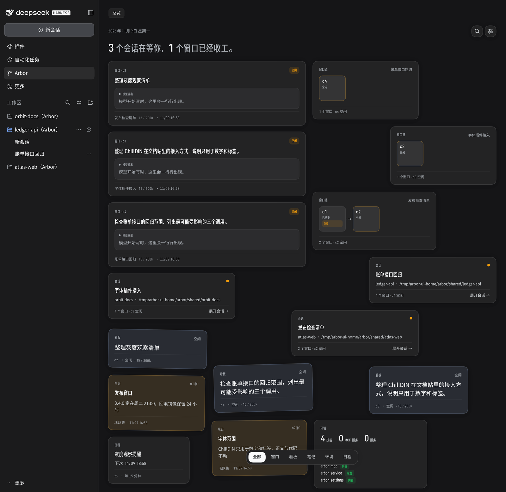

# dsh-arbor-fonts

An optional DeepSeek Harness client plugin that sets the typography of the
Arbor page from [dsh-arbor](https://github.com/4fuu/dsh-arbor): **ChillDIN
Gothic** for display labels and **ChillDIN** for numerals. Body text and code
keep DSH's own fonts. Nothing else changes.

The plugin is one package, `@4fu/dsh-arbor-fonts`. It is not required by
dsh-arbor and has no effect on ordinary DSH pages.

## What it changes

dsh-arbor owns the typography contract:

- every text node on the Arbor page and its session tabs carries
  `data-arbor-text` = `body` | `display` | `numeric` | `code`;
- the Arbor root sets `--arbor-font-body`, `--arbor-font-display`,
  `--arbor-font-numeric` and `--arbor-font-code`, defaulting to DSH's own
  font tokens.

This plugin overrides only `--arbor-font-display` and `--arbor-font-numeric`.
The rules are scoped to `[data-arbor-page]` and to the contract-pinned
`[data-arbor-text]` nodes, so an ordinary DSH element cannot match them:

- `display` becomes "Arbor ChillDIN Gothic" at its single 500 weight, with
  `font-synthesis: none` so it is never synthetically bolded;
- `numeric` becomes "Arbor ChillDIN" at weights 400, 500 and 600, with the
  page's existing tabular numerals;
- `body` and `code` are untouched.

The stylesheet is injected lazily, only after an Arbor root or a
`[data-arbor-text]` node exists. A browser fetches a `@font-face` file only when
a matching family is used, so a DSH page with no Arbor UI makes no font request
from this plugin. The plugin's client bundle is still loaded with the normal DSH
plugin graph; its `apply` only installs a `MutationObserver` until the page
appears.

## Screenshots

The same Arbor overview at 1440 px wide, without and with the plugin:

| Without the plugin | With the plugin, light |
| --- | --- |
|  |  |

With the plugin, dark:



The labels and numerals change; the body text, code, layout and colours are
DSH's own.

## Install

Requirements: the same DSH version dsh-arbor uses, a `web` profile with
dsh-arbor installed, and the package built. The built `lib/index.js` and
`client.js` are committed because a profile install does not run a build.

```bash
dsh plugin --profile web add file:/absolute/path/to/packages/dsh-arbor-fonts
```

Then insert the Host row in the profile's `cordis.patch.yml`:

```yaml
- insert:
    - id: arbor-fonts
      name: '@4fu/dsh-arbor-fonts'
```

Restart the profile. The package must be visible in the profile's
`node_modules`; `dsh plugin add` writes the dependency. The Host half registers
four exact Fetch routes under `/api/arbor-fonts/`; the browser half installs the
stylesheet when the Arbor page appears.

On a profile with no browser connection (headless, acp, sdk) the Host plugin
stays inactive and registers no route. Nothing changes on those profiles.

## DSH version

The plugin is built for **`dsh-v0.2.2-rc.1`** (`@deepseek-ai/dsh@0.2.2-rc.1`).
The package manifest records that in `dsh.compatible`; DSH itself reads only
`dsh.client`, and `pnpm check:pin` checks the recorded version. A different DSH
version is unsupported: the plugin depends on DSH's exact Fetch registry
(`HostConnectionFetch.register`) and on the Arbor page's contract. On another
version it may register no route or answer 404 from another asset path. The
same pin applies to dsh-arbor; see its
[versions page](https://github.com/4fuu/dsh-arbor/blob/main/docs/versions.md).

## Fonts and licensing

The four vendored faces come from
[Warren2060/ChillDIN-ChillDINGothic](https://github.com/Warren2060/ChillDIN-ChillDINGothic)
at commit `d5251e66ded29639397025784c72dc2ac12bc817`, under the SIL Open Font
License 1.1. The full OFL text is at
[`packages/dsh-arbor-fonts/fonts/ChillDIN-OFL.txt`](packages/dsh-arbor-fonts/fonts/ChillDIN-OFL.txt);
per-file SHA-256 values, families and weights are in
[`packages/dsh-arbor-fonts/fonts/README.md`](packages/dsh-arbor-fonts/fonts/README.md).
No font file was modified or subsetted.

Attribution, as carried by the upstream files:

> Copyright 2023 ChillType, with Reserved Font Name 'ChillDIN'
> 'ChillDINGothic'. Copyright 2014-2021 Adobe (http://www.adobe.com/), with
> Reserved Font Name 'Source'.

The plugin's source code is MIT. The fonts are OFL-1.1. Both license texts and
the attribution ship with the package; see [LICENSE](LICENSE) and
[NOTICE](NOTICE).

## Develop

```bash
.agents/setup   # pinned pnpm and dependencies
pnpm check      # pin check, build, typecheck and tests
pnpm build      # regenerate lib/index.js and client.js
```

`pnpm check` must pass on a clean clone after `.agents/setup`. The tests cover
the four routes, the scoped selectors, the lazy installation and the built
files; they fail when the manifest and the vendored files disagree.

## Layout

```text
packages/dsh-arbor-fonts/
  src/client.ts          the browser half: lazy stylesheet, scoped overrides
  src/index.ts           the Host half: registers the exact Fetch routes
  src/routes.ts          the four content-addressed font routes
  src/font-manifest.ts   generated hashes, families, weights and URLs
  fonts/                 the vendored faces, the OFL text and the attribution
  lib/index.js           the built Host entry
  client.js              the built browser entry
  test/                  route, scoping and built-file tests
```
